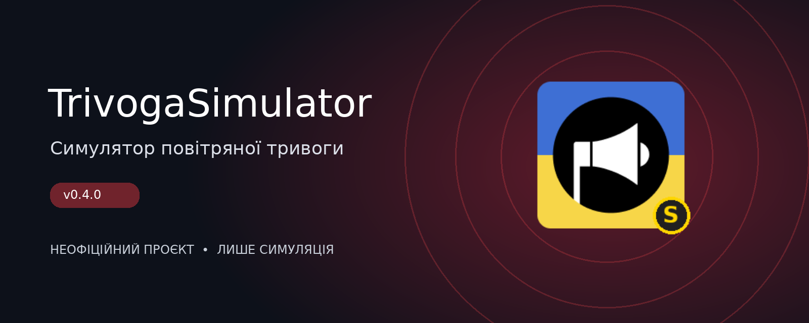

# TrivogaSimulator

**Неофіційний симулятор сповіщень про повітряну тривогу для Android**

`v0.4.0` · `Українська мова` · `Симуляція` · `Незалежний проєкт`

## Про проєкт

**TrivogaSimulator** — застосунок, у якому можна створювати власні сценарії повітряних тривог та інших небезпек і спостерігати, як вони відображаються на мапі України та в сповіщеннях.

Проєкт натхненний застосунком **«Повітряна тривога»**, розробленим за участю **Ajax Systems** і **Stfalcon**, але створений незалежно. Усі події в TrivogaSimulator моделює користувач: вони **не відображають реальну безпекову ситуацію**.

## Що можна робити

- **Оголошувати тривоги** для областей, районів і населених пунктів, зокрема вибірково для кількох територій.
- **Керувати рівнями тривоги:** використовувати жовтий і червоний рівні, змінювати їх та оголошувати відбій.
- **Працювати з мапою України:** переглядати змодельовані тривоги на загальній мапі й детальніше в окремих регіонах.
- **Додавати умовні загрози:** позначати місця появи небезпеки та відтворювати відповідні сповіщення.
- **Планувати сценарії:** налаштовувати події на майбутній час і автоматичне завершення там, де це передбачено сценарієм.
- **Переглядати історію:** повертатися до журналу змодельованих подій.
- **Експериментувати:** запускати незвичайні та жартівливі сценарії окремо від реальних повідомлень.

## Для чого це

TrivogaSimulator підходить для демонстрацій, творчих сценаріїв, знайомства з принципами відображення сповіщень та експериментів із поведінкою умовної системи оповіщення. Він не призначений для отримання інформації про поточні загрози або ухвалення рішень щодо безпеки.

## Важливо: це симуляція

> **Жодна тривога, відбій або позначка загрози в цьому застосунку не є офіційним попередженням.** TrivogaSimulator не передає реальні сповіщення та не замінює офіційні канали оповіщення. У разі небезпеки керуйтеся повідомленнями органів влади та офіційними системами оповіщення.

Не використовуйте зображення або записи із симулятора так, щоб інші люди могли сприйняти їх як справжні повідомлення про загрозу.

## Незалежність проєкту та права власників

TrivogaSimulator — **неофіційний незалежний проєкт**. Його автор **не співпрацює і не співпрацював** з **Ajax Systems**, **Stfalcon** або командою офіційного застосунку «Повітряна тривога» в межах створення цього симулятора. Проєкт **не афілійований, не схвалений, не підтримується та не фінансується** цими компаніями.

Назви «Повітряна тривога», Ajax Systems і Stfalcon згадуються лише для пояснення джерела натхнення та порівняння. Усі права на відповідні назви, торговельні марки, логотипи та інші матеріали належать їхнім законним власникам. Автор не заявляє прав на чужі торговельні марки або офіційний застосунок.

Якщо правовласник вважає, що певний елемент проєкту порушує його права, автор готовий розглянути обґрунтоване звернення та за потреби змінити або прибрати відповідний матеріал.

## Версія

Поточна описана версія: **0.4.0**.

> Інформацію про доступність APK та порядок встановлення слід брати з фактичної сторінки релізу цього репозиторію, якщо вона опублікована.

---

TrivogaSimulator · Неофіційний симулятор · Жодних реальних тривог

